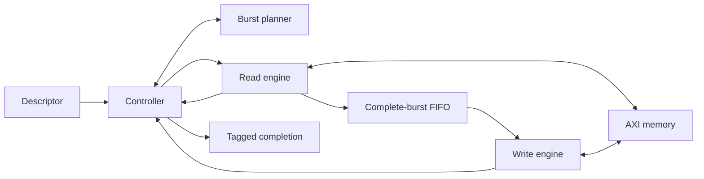

# DMA architecture

This is a sequential store-and-forward copy engine. The structural top is
[`axi_dma`](../rtl/axi_dma.sv); all state is in one clock domain.

1. **Accept and validate.** The controller captures a descriptor only on valid/ready.
   Widened address arithmetic catches wrapping ranges, including at 64-bit endpoints.
   Invalid descriptors return status 1 with no AR or AW activity.
2. **Plan and register.** The combinational planner chooses the minimum of remaining
   beats, the project limit, and both page limits. The controller registers that
   chunk before handing it to an engine. Engine addresses and beat counts then hold
   under backpressure. AXI length encodes the registered count minus one.
3. **Read the whole chunk.** The reader issues one AR and forwards accepted R beats
   into the FIFO. RID, response code, and expected RLAST are checked on handshakes.
   Errors accumulate while the expected beat count is drained. A failed read causes
   a FIFO flush and status 2; its corresponding write is never requested.
4. **Write the whole chunk.** Only a successful read result enables AW. The FIFO's
   show-ahead data drives W. A FIFO pop and accepted W beat are identical events.
   The writer waits for B after its final W beat. An erroneous BID/response stops
   the descriptor with status 3, retaining all accepted write effects.
5. **Advance or complete.** Only a successful write result advances both addresses
   and subtracts the chunk bytes. The next chunk starts with an empty FIFO. The final
   successful B leads to a tagged status-0 completion that holds until accepted.

The FIFO's occupancy, not a sentinel pointer value, distinguishes empty and full.
Pointers wrap explicitly, so depths 1, 3, and 5 are safe. Full and empty cycles use
conservative rules: no full-cycle replacement push and no empty-cycle bypass.

Active-low reset is sampled synchronously, but handshake outputs are suppressed
while reset is low. Reset cancels work, a pending result, or a stalled completion.
The test memory retains accepted bytes so partial writes can be checked after reset.

The verification layers are independent: Python creates planner vectors; engine
benches drive protocol peers directly; the controller bench supplies abstract engine
results; the memory model is tested without the DMA; and the system scoreboard uses
external handshakes and a separate byte image rather than inspecting DUT state.

## Multiple channels

`axi_dma_multi` places an input descriptor FIFO and an output completion FIFO on
each channel. The round-robin arbiter selects an eligible descriptor when the shared
core is idle. Eligibility requires both a queued descriptor and completion space.
The selected channel remains the owner until the core result is queued. This reserves
a completion slot and lets eligible peers progress when another channel's consumer
stalls. Arbitration is by complete descriptor; AXI bursts are not interleaved.

## Two-clock interface

`axi_dma_cdc` adds per-channel asynchronous descriptor FIFOs from `ctrl_clk` to
`axi_clk` and completion FIFOs in the reverse direction. Registered Gray pointers
cross through two-stage synchronizers; the DMA and AXI channels remain in `axi_clk`.
Either reset request cancels both domains, with asynchronous assertion and local
synchronized release. See [CDC.md](CDC.md) for the crossing inventory, reset topology,
and physical integration requirements.

See [EXTENSION_SPEC.md](EXTENSION_SPEC.md) for ownership and queue contracts and
[PERFORMANCE.md](PERFORMANCE.md) for instrumentation and software prediction.
