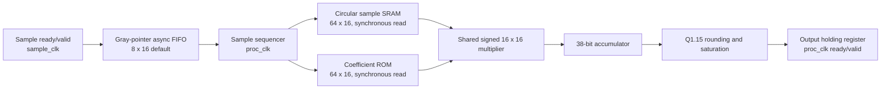

# 64-Tap FIR Filter with a Shared MAC

A local reconstruction of the September–December 2023 project description:
64 taps, signed 16-bit samples and coefficients, one shared multiply–accumulate
datapath, circular sample SRAM, and an asynchronous FIFO between independent
sample and processing clocks. The source uses synthesizable SystemVerilog and
includes toolbox-free MATLAB reference code.

The original sources, coefficient specification, target technology, and historical
reports were not provided. The implementation and example lowpass coefficients
here are new; measured results below describe this reconstruction.

See [implementation provenance](docs/provenance.md) for the source-origin record,
standard design techniques, and review scope.



## Run locally

Only Python 3.9+, Icarus Verilog with SystemVerilog support, and `make` are needed
for the portable regression. Run commands from this folder:

```sh
make test             # Reference checks, 12 FIFO cases, 5 FIR cases
make activity         # Also writes build/activity.vcd and an RTL toggle report
make check-vectors    # Confirm deterministic checked-in coefficients and vectors
make vectors          # Regenerate them with the Python oracle
```

Verified with Icarus Verilog 13.0: **17 configurations passed and 9,740 FIR
outputs matched**, including every 38-bit accumulator result. Tests exercise
FIFO depths 2/4/8/16, clock ratios and phases, full/empty and pointer wrapping,
input and output stalls, impulse/step/full-scale/random samples, both saturation
directions, half-way rounding, and reset during a MAC and a stalled output.
See [the measured snapshot](reports/README.md).

## Numerical and interface contract

| Property | Contract |
| --- | --- |
| Filter | `acc[n] = sum(c[k] * x[n-k], k=0..63)`; pre-reset history is zero |
| Sample / coefficient | Signed 16-bit Q1.15 (integer code divided by 32768) |
| Multiply / accumulate | Signed 32-bit product / signed 38-bit exact sum, 30 fractional bits |
| Output | Round `acc / 32768` to nearest, ties away from zero; saturate to −32768…32767 |
| Debug result | `m_acc` is the exact 38-bit sum, stable with `m_data` under backpressure |
| Input | Transfer on `s_valid && s_ready` at `sample_clk`; hold data and valid while stalled |
| Output | Transfer on `m_valid && m_ready` at `proc_clk`; data and valid hold while stalled |
| Reset | Shared active-low `arst_n`; asynchronous assertion, locally synchronized release |
| Default FIFO | 8 entries; `FIFO_ADDR_BITS` changes depth to `2**FIFO_ADDR_BITS` (1…16 supported) |
| Coefficients | Static hex file selected by `COEFF_FILE`; no runtime update interface |

The core completes a dot product 65 processing edges after removing its sample
from the FIFO. Its earliest output transfer and next sample removal occur on
edge 66. Maximum sustained throughput is **`f_proc / 66`** with no stalls:
at an *assumed* 100 MHz processing clock, 1.515 million samples/second.
This is an architectural calculation, not a timing-closure result. FIFO depth
absorbs bursts; it cannot compensate for sustained input above this rate.
Both clocks must continue toggling for FIFO progress. Output stays in the
processing clock domain.

## MATLAB flow

```sh
make matlab MATLAB=/path/to/MATLAB/bin/matlab
make compare-matlab
```

`matlab/generate_vectors.m` independently designs the coefficients, generates a
fixed-seed xorshift32 sample sequence, and uses direct convolution for expected
integer outputs. It writes to `build/matlab_vectors/` so comparing implementations
does not overwrite the checked-in vectors. `analyze_filter.m` saves frequency and
impulse-response plots and reports fixed-point error. No DSP toolbox is required.

MATLAB R2022a was found locally but could not start because its license has
expired (License Manager Error −10). Consequently, MATLAB execution and
MATLAB/Python agreement are **not claimed**. The checked-in corpus was generated
and verified with Python; it uses the same documented arithmetic and stimulus
recipe as the MATLAB source.

## Synthesis, timing, and power

```sh
make synth
make synth-mapped LIBERTY=/path/to/standard_cells.lib
make sta LIBERTY=/path/to/standard_cells.lib
make gate-activity CELL_MODELS=/path/to/standard_cell_models.v
make power LIBERTY=/path/to/standard_cells.lib
```

Yosys and OpenSTA are not installed in this workspace environment, and no target
library was supplied. These flows are provided but have not been executed here;
there are no claimed area, Fmax, slack, or power measurements. See
[PPA methodology](docs/ppa.md) for required inputs, assumptions, and report paths.
`make activity` measures RTL transitions; it does not report watts.

`fir_sample_sram` is a synchronous-read memory inference wrapper. FPGA tools may
infer embedded RAM; an ASIC requires macro mapping and a macro timing/power model.
The example generic standard-cell synthesis flow maps memories to registers and
muxes, so its area and power cannot be presented as SRAM-macro results.
The FIFO has an asynchronous read and is intended for distributed RAM or flops;
substituting synchronous-read block RAM changes its interface timing.

## Files

| Path | Purpose |
| --- | --- |
| `rtl/` | Filter, reset synchronizers, async FIFO, SRAM, coefficient ROM |
| `tb/` | Self-checking FIR and FIFO simulations |
| `model/` | Dependency-free integer oracle, vector generation, arithmetic checks |
| `matlab/` | Independent vector generator and response analysis |
| `coefficients/` | Default Hamming lowpass, accumulator stress, half-way-rounding profiles |
| `vectors/` | Reproducible input/output/accumulator hex files and hash manifest |
| `scripts/` | Regression, activity analysis, synthesis, gate simulation, STA and power |
| `constraints/` | Demonstration pre-layout SDC |
| `docs/` | [Architecture](docs/architecture.md), [verification](docs/verification.md), [CDC](docs/cdc.md), [PPA](docs/ppa.md) |
| `reports/` | Compact measured-result snapshots; logs and waveforms are in ignored `build/` |

There are no vendor IP dependencies. No commits are required to run any flow.
